<!-- ============ HEADER ============ -->
<div align="center">


<a href="https://git.io/typing-svg">
  
</a>

<br/>

[](https://www.linkedin.com/in/zen-abhay)
[](https://x.com/zen_abhay)
[](mailto:abhay2four+business@gmail.com)


</div>

---

## `~/about`

```bash
$ whoami
zen-abhay

$ cat about.txt
Computer Science undergrad at Amity University Madhya Pradesh.
Into backend systems, Android, and machine learning.
Currently deep in: Discrete Mathematics, Neural Networks, Deep Learning.

$ echo $STATUS
building things worth showing. (soon)
```

---

## `~/stack`

**Languages**


**Back-end**


**Frontend**


**Cloud and tooling**


**AI / ML**


---

## `~/projects`

```console
$ git log --oneline --all --author="zen-abhay"
fatal: your current branch 'main' does not have any commits yet

$ ls ./flagship-project
ls: cannot access './flagship-project': No such file or directory

$ ./build.sh
[#####-----------------]  23%  compiling ideas...
[!] WARN  scope creep detected, ignoring
[ok] coffee.service started

$ git status
On branch main
Untracked files:  project_01/  project_02/  project_03/
(use "git add" to track, soon)
```

<!-- TODO: replace each card below with a real repo link once the project exists -->

<table>
  <tr>
    <td width="33%" valign="top">
      <b>📦 project_01</b><br/>
      <sub><code>status: sketching</code></sub><br/><br/>
      <i>Backend service. FastAPI + MongoDB + JWT auth.</i><br/><br/>
      
    </td>
    <td width="33%" valign="top">
      <b>📦 project_02</b><br/>
      <sub><code>status: planning</code></sub><br/><br/>
      <i>Android app. Kotlin + Gradle.</i><br/><br/>
      
    </td>
    <td width="33%" valign="top">
      <b>📦 project_03</b><br/>
      <sub><code>status: researching</code></sub><br/><br/>
      <i>ML pipeline. PyTorch + XGBoost + feature engineering.</i><br/><br/>
      
    </td>
  </tr>
</table>

<div align="center">
<sub><i>Every good repo starts as an empty folder. Check back soon.</i></sub>
</div>

---

## `~/activity`

<div align="center">


<br/><br/>

<picture>
  <source media="(prefers-color-scheme: dark)" srcset="https://raw.githubusercontent.com/zen-abhay/zen-abhay/output/pacman-contribution-graph-dark.svg">
  <source media="(prefers-color-scheme: light)" srcset="https://raw.githubusercontent.com/zen-abhay/zen-abhay/output/pacman-contribution-graph.svg">
  
</picture>

<br/>


</div>

---

<div align="center">

```
$ echo "Open to internships and collaborations"
```

[abhay2four+business@gmail.com](mailto:abhay2four+business@gmail.com)


</div>
